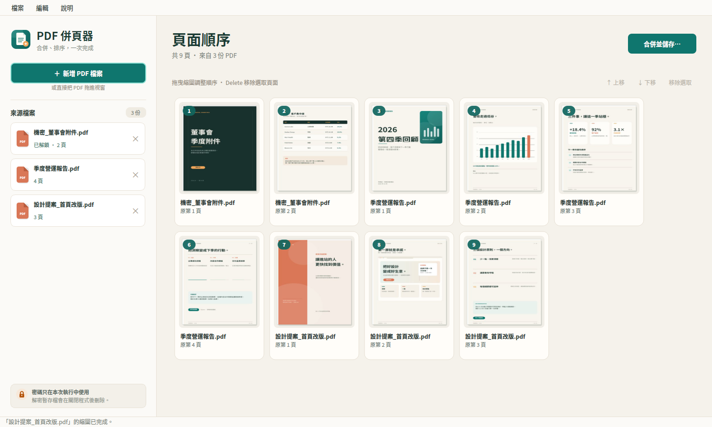
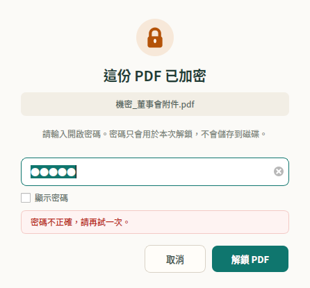

# PDF 併頁器

本機桌面工具：把多份 PDF 合併成一份，並用縮圖逐頁調整順序。加密的 PDF 會在加入時逐份詢問密碼；當下不想輸入也可以先跳過，之後再從左側清單解鎖。

目前版本：**1.0.0** · [版本歷程](CHANGELOG.md) · [v1.0.0 發佈說明](docs/release-notes-v1.0.0.md)



## 功能

- 一次加入多份 PDF，支援拖放檔案到視窗。
- 加密 PDF 逐檔輸入密碼；支援密碼錯誤後直接重試。
- 可跳過密碼，來源會保留在左側，之後按「解鎖」再加入頁面。
- 所有 PDF 的頁面會排成同一個縮圖畫廊。
- 直接拖曳縮圖即時換位；靠近上下邊緣會自動捲動，也可用「上移／下移」按鈕。
- 可多選頁面後刪除（Delete）。
- 有未解鎖檔案時會明確提醒，合併前再次確認。
- 合併結果以暫存檔寫入後原子替換，避免留下半成品。
- 密碼框可切換顯示密碼；高 DPI 縮圖與中英文檔名皆支援。

## 安裝 Debian／Ubuntu 套件

已提供可直接用 apt 安裝的 `.deb`：

```bash
cd /home/liao/.zcode/workspace/449f8f0c-0603-4541-b26e-8bccd39a56b8/pdf-merger
sudo apt install ./dist/pdf-page-merger_1.0.0-1_all.deb
```

apt 會自動補齊 `python3-pypdf` 等缺少的依賴；安裝後可從應用程式選單啟動「PDF 併頁器」，或執行：

```bash
pdf-page-merger
```

驗證下載的套件：

```bash
cd dist
sha256sum -c SHA256SUMS
```

移除：

```bash
sudo apt remove pdf-page-merger
```

## 從原始碼啟動

```bash
cd /home/liao/.zcode/workspace/449f8f0c-0603-4541-b26e-8bccd39a56b8/pdf-merger
./run.sh
```

第一次啟動時，`run.sh` 會建立 `.venv` 並安裝缺少的套件。也可以直接把 PDF 拖到 `run.sh` 上，或執行：

```bash
./run.sh 報告.pdf 附件.pdf
```

若不用 `.deb`，可另外建立原始碼版本的選單捷徑（不要和 `.deb` 版本同時安裝，以免選單出現兩個相同項目）：

```bash
./install-desktop-entry.sh
```

之後可以在應用程式選單搜尋「PDF 併頁器」。若把資料夾搬家，重新執行一次即可更新捷徑。

## 操作方式

1. 按「新增 PDF 檔案」，或把多份 PDF 拖進視窗。
2. 遇到加密檔案時輸入該檔密碼。按「取消」不會刪掉來源，之後按來源右側的「解鎖」即可。

   

3. 在右側縮圖畫廊拖曳頁面，調整成想要的合併順序。
4. 按右上角「合併並儲存…」，選擇輸出位置。
5. 完成後可直接開啟 PDF 或所在資料夾。

### 快速鍵

| 操作 | 快速鍵 |
| --- | --- |
| 新增 PDF | `Ctrl+O` |
| 合併並儲存 | `Ctrl+S` |
| 上移目前頁面 | `Alt+↑` |
| 下移目前頁面 | `Alt+↓` |
| 移除選取頁面 | `Delete` |
| 結束程式 | `Ctrl+Q` |

## 密碼與暫存檔

- 密碼只存在記憶體中，用來讓 pypdf 解鎖與建立工作副本，不會寫入設定檔或日誌。
- 加密 PDF 解鎖後會在 `/tmp/pdf-page-merger-*` 建立權限 `0700` 的暫存工作副本；縮圖也放在同一個資料夾。
- 正常關閉程式時會刪除整個暫存資料夾。若程式被強制終止，暫存檔可能留在 `/tmp`，可手動刪除。
- 來源 PDF 永遠不會被修改；輸出檔是新的、未加密的 PDF。
- 合併結果不會保留書籤、表單欄位、附件或數位簽章的有效性。頁面內容、尺寸與旋轉會保留。

## 環境需求

- Linux 桌面環境，Python 3.10 以上；`.deb` 以 Ubuntu 26.04／Debian 的套件名建置。
- `.deb` 的執行期依賴：`python3-pyside6.qtwidgets`、`python3-pypdf`、`python3-cryptography`、`poppler-utils`。apt 會自動安裝缺少的項目。
- 從原始碼啟動時，`run.sh` 會在 `.venv` 安裝 PySide6、pypdf 與 cryptography。
- `.deb` 建議安裝 `fonts-noto-cjk`（中文字型）與 `xdg-utils`（開啟輸出 PDF）；兩者列為 Recommends。
- 沒有 `poppler-utils` 時仍可合併，但不會顯示頁面縮圖。

以 Debian／Ubuntu 手動補齊縮圖工具：

```bash
sudo apt install poppler-utils
```

## 重新打包 `.deb`

```bash
./packaging/build-deb.sh
```

輸出為 `dist/pdf-page-merger_1.0.0-1_all.deb`，並附上 `dist/SHA256SUMS`。可用環境變數改版號：

```bash
VERSION=1.1.0 REVISION=1 ./packaging/build-deb.sh
```

建置只需要 `dpkg-deb`、`gzip` 與 `desktop-file-validate`（後者為選用驗證）。

## 發佈到 GitHub

版本庫已包含 `v1.0.0` 標籤與發佈說明。登入 GitHub CLI 後可一次建立遠端、推送並建立 Release：

```bash
sudo apt install gh
gh auth login
./packaging/publish-github.sh
```

預設建立**私有**倉庫；若要公開，使用：

```bash
VISIBILITY=public ./packaging/publish-github.sh
```

腳本會附上 `.deb` 與 `SHA256SUMS` 到 GitHub Release。

## 測試

先執行一次 `./run.sh` 建立 `.venv`（或手動建立虛擬環境並安裝 `requirements.txt`），再執行：

```bash
cd /home/liao/.zcode/workspace/449f8f0c-0603-4541-b26e-8bccd39a56b8/pdf-merger
QT_QPA_PLATFORM=offscreen .venv/bin/python tests/make_samples.py
QT_QPA_PLATFORM=offscreen .venv/bin/python -m unittest discover -s tests -p 'test_*.py' -v
```

測試涵蓋：

- 加密 PDF 的密碼需求、錯誤密碼、正確解鎖，以及只有擁有者密碼的情況。
- 解密工作副本、縮圖產生與取消。
- 任意頁序合併、重複頁、取消合併、拒絕覆蓋來源、錯誤清理。
- GUI 的加入檔案、縮圖載入、實際滑鼠拖曳換位、頁面刪除、解鎖狀態、合併輸出。

範例檔會產生在 `tests/samples/`，其中 `機密_董事會附件.pdf` 的密碼是 `open123`。可直接用來試工具。

## 專案結構

```text
pdf-merger/
├── main.py                  # 程式入口
├── main_window.py           # 主視窗與操作流程
├── ui_pages.py              # 頁面縮圖畫廊、拖曳排序
├── ui_widgets.py            # 來源列、密碼對話框
├── pdf_engine.py            # 解密、縮圖、合併（無 Qt 相依）
├── workers.py               # 背景縮圖與合併工作
├── icons.py / theme.py      # 介面圖示與樣式
├── assets/                  # SVG／PNG 應用程式圖示
├── packaging/               # .deb 建置腳本、desktop、man、授權與 changelog
├── dist/                    # 建置產物：.deb 與 SHA256SUMS
├── tests/                   # 單元測試、GUI 測試、範例 PDF 產生器
├── run.sh
└── install-desktop-entry.sh
```
